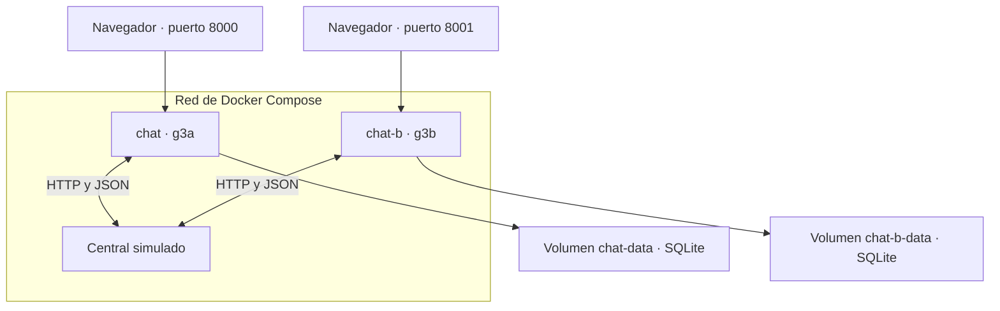

# Chat distribuido

Chat para el canal `#general`. Los servidores de grupo están implementados con FastAPI, guardan sus datos en SQLite y se comunican con un servidor central mediante HTTP y JSON.

## Arranque en un equipo limpio

Instala Docker Desktop con Docker Compose, abre el repositorio y ejecuta este comando desde la carpeta donde está `docker-compose.yml`:

```powershell
docker compose -f docker-compose.yml -f docker-compose.test.yml up -d --build
```

| Servicio | Dirección | Función |
|---|---|---|
| `chat` (`g3a`) | [localhost:8000](http://localhost:8000/) | Primer servidor de chat |
| `chat-b` (`g3b`) | [localhost:8001](http://localhost:8001/) | Segundo servidor de chat |
| `central` | `http://central:8000` | Central simulado, accesible dentro de la red de Docker |

Abre los dos chats, registra un usuario en cada uno y envía un mensaje desde cualquier lado. El mensaje debe aparecer en el otro chat con el grupo de origen junto al nombre del usuario.

Para detener el entorno de prueba:

```powershell
docker compose -f docker-compose.yml -f docker-compose.test.yml down
```

## Arquitectura



Cada chat monta su propio volumen en `/data`. SQLite conserva los usuarios, el historial, el reloj de Lamport y la cola de mensajes pendientes. El central simulado conserva su historial en memoria durante la ejecución.

## Variables de entorno

| Variable | Función | Ejemplo para `g3a` |
|---|---|---|
| `GROUP_NAME` | Identifica al servidor que se registra. | `g3a` |
| `CENTRAL_URL` | Dirección del central que consulta el chat. | `http://central:8000` |
| `PUBLIC_URL` | Dirección que el chat anuncia para recibir mensajes del central. | `http://chat:8000` |
| `DATABASE_PATH` | Ruta de SQLite dentro del contenedor. | `/data/chat.db` |

`docker-compose.test.yml` configura la federación local. Para la sesión del curso, se necesitan el identificador asignado, la URL del central oficial y una dirección anunciada que ese central pueda alcanzar.

## Decisiones de diseño

- El servidor se registra en el central y comprueba su disponibilidad periódicamente.
- Cada mensaje tiene un UUID. La base de datos usa ese identificador para evitar duplicados cuando el central reenvía un mensaje o el chat recupera el historial.
- El historial se ordena por marca de Lamport, grupo de origen e identificador. La hora física se conserva como dato informativo.
- El mensaje local y su entrada en la cola se guardan en la misma transacción. Ante errores de conexión o respuestas HTTP 5xx, el envío se reintenta con espera exponencial.
- Al arrancar o recuperar la conexión, el chat consulta el historial del central e incorpora los mensajes que le faltan.

## Pruebas y experimento

- [Pruebas de federación](pruebas-federacion.md)
- [Método y resultados del experimento](experimento.md)
- [Script de medición](medir_latencia.py)
- [Datos de latencia en CSV](resultados-latencia.csv)